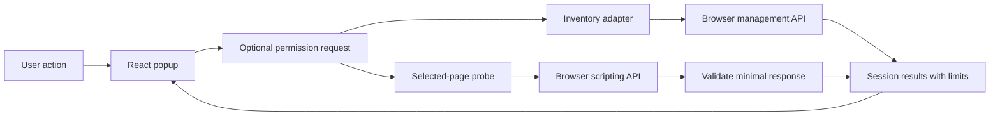

# Architecture

## Initial shape

Use WXT, TypeScript, and React in a single extension project. Configure Firefox and Chrome Manifest V3 explicitly because WXT's Firefox default is MV2. Reject other browser and manifest targets until separately approved. Start with a popup, small browser adapters, a capability model, and tests. Add a background coordinator only when a later recording workflow requires one. Firefox MV3 uses background scripts/event pages rather than a Chrome-only service worker.

The interface owns the temporary session. The inventory adapter accepts the browser API boundary and produces normalized entries. The probe adapter selects the active tab, injects a self-contained function into the default isolated world, validates its small response, and returns a typed outcome. A shared capability model describes supported, permission-dependent, unsupported, unavailable, and untested behavior without confusing those states.

The first Phase 1 slice adds an inventory-scoped React component with local search and state filters. It derives visible rows from the already loaded inventory and looks up static permission explanations without browser calls. The component exists only while the session has a successful inventory. Clear, revocation, refresh, and closing the popup remove it and discard its display state. The default black palette needs no saved theme preference.

## Permission boundary

Require only `activeTab` in the initial manifest. Declare `management` and `scripting` as optional. Request the relevant permission directly in the action handler, before unrelated asynchronous work can lose the user gesture. API access occurs only after the request succeeds. Requesting an already granted optional permission still follows an explicit click.

Do not declare broad host permissions, `tabs`, `webRequest`, `storage`, or `nativeMessaging` in Phase 0. A missing browser API is an unavailable outcome, not an excuse to request broader access.

The current runtime keeps that budget. The 2026-11-06 contracts approve two future optional paths: `webRequest` plus a temporary scheme+host grant for the request-failure check, and `nativeMessaging` for the optional companion. The host grant may cover all ports on that host; only the runtime origin filter limits collection to the selected origin, including its effective port. Neither path is a current permission or install-time host grant. Their implementation must request access only at the explicit user action, inside a demonstrated supported activation path, and fail closed without broader fallback. The request check preserves pre-existing grants and removes only the access it newly acquired; grant ownership and expected cleanup stay in the live check owner's and participating views' memory, with no persistent origin record. The companion permission remains a user-managed optional grant.

## Data and trust boundaries

The inventory is sensitive because extension choices can reveal user interests. Keep it in the visible interface's memory. Normalize only fields the product displays. Do not load remote icons or contact extension homepages.

The page probe collects no identifiers or content. Validate document readiness against known values, performance type values as bounded strings, and response length before rendering. Render text through React. Do not insert HTML or execute returned strings.

Keep permission grants distinct from data retention. The browser can retain a grant after the popup closes. AddonRay retains live diagnostics only until their owning view ends; explicit Save creates a bounded local archive under the saved-investigation rules. In-flight operations must not repopulate cleared or revoked results.

## Manual comparison ownership

The approved [manual comparison](plans/phase1-comparison.md) adds an unlisted WXT investigation page and keeps the popup as a separate session. Each New investigation click creates a fresh extension-owned tab through `tabs.create` and `runtime.getURL`; no sensitive-metadata `tabs` permission is needed. Opening the route collects nothing.

`lib/investigation.ts` owns one Before/After pair and the user's assessment. It reuses the inventory adapter's explicit consent, then copies only the displayed ID/name/version/enabled fields. `lib/comparison.ts` computes exact-ID additions, removals and enabled-state transitions. Failed After captures retain Before for retry; a successful pair stays fixed until Start over. No comparison code selects or inspects a source page.

The loaded investigation document owns its memory and permission listener. Start over/revocation invalidate the generation and abort pending work; the last subscriber leaving discards the state. Fresh documents start empty. There is no transfer from the popup, background coordinator, storage, or single-instance coordination. [ADR 0003](adr/0003-investigation-page-lifetime.md) records the lifetime/recovery trade-off. Existing inspection permission grants can persist after every view has closed, independently of retained data.

## Approved timing snapshot

The first Phase 2 slice extends `PageObservation` in `lib/inspector.ts` with three fixed milestone results. The existing isolated-world collector reads the current top-frame document once and constructs only allowed fields. Its serialized function remains self-contained. It installs no listeners, observers, timers, or page-world bridge.

The adapter validates numeric bounds and measured/unrecorded/unavailable shapes before making independent canonical copies. Event-end zero is unrecorded; a reported zero paint timestamp remains valid. Missing APIs or entries remain unavailable. `PageTimings` renders the fixed results with meanings and limitations in the existing popup. The current session owns replacement, busy guards, clearing, cancellation, and permission listeners. No comparison owner, coordinator, message channel, navigation monitor, or durable state changes.

The selected tab is bound at the click, while its document at execution supplies the snapshot. The design does not claim exact click-time document identity. SPA navigation and restored pages may expose original loading milestones. Browser tests qualify isolated-world visibility, minimized raw output, the bounded block size, and synchronous execution overhead separately from test-controller authority and native popup behavior.

## Optional timing comparison integration

The approved [timing-comparison slice](plans/phase2-timing-comparison.md) extends the original independent-view model with explicit transfer. `capturePage` keeps the browser-selected tab ID and context classification beside its validated observation; `inspectPage` preserves the existing observation-only adapter contract. The popup session owns a capture sequence and one-use marker, separate from the page-provided timing block.

`lib/timing-handoff.ts` lists only own loaded investigation views through `extension.getViews`. Its public discovery result contains copied primitive identity/label/generation/eligibility metadata, with no Window reference or investigation data. At confirmation it resolves the chosen document again. The receiver verifies the current packaged popup, normal-window classification, permissions, reset generation, side eligibility, and current source capture before committing.

The investigation owns fixed optional Before/After timings and the source-tab binding. Starting After inventory closes Before timing attachment, even when inventory fails. Canonical timing objects are constructed in the receiving realm; discovery arrays and acknowledgments must likewise belong to their receiving document. Firefox can invalidate objects owned by closed views, so no sender-owned array/object/function enters retained snapshot state. Stale cross-view access becomes a bounded failure.

The transfer adds no background process, host grant, storage, external listener, page-world channel, or tab monitor. The views share the extension trust domain. Endpoint checks constrain product entry points; they do not create a security sandbox between compromised extension documents. Either optional-permission revocation resets the investigation, while popup Clear and other investigations remain independent.

## Approved page-error check design

The [approved collector](plans/phase2-page-errors.md) adds a separate unlisted check page with one in-memory attempt and a narrow browser adapter. `lib/page-error-check.ts` owns the bound source identity, start/stop/reset generations, canonical summary, and permission cancellation. It does not extend timing snapshots or investigation comparisons. The popup-to-check bootstrap must transfer only the selected numeric source-tab ID through a verified own-view boundary before activating the new check tab; IDs never enter the route.

[ADR 0004](adr/0004-page-error-execution-worlds.md) selects Firefox ISOLATED and Chrome MAIN only for error observation. `lib/page-error-observer.ts` installs an isolated supervisor connected to the original source frame and its visible check owner. Chrome's separate page-side function uses a narrow DOM control bridge without extension APIs or browser-action commands. Page-visible attempt tokens are not authentication secrets. `lib/page-error-browser.ts` requests consent, verifies context/access, controls the existing port and validates final results. Candidate lifecycle gates passed before product wiring; [delivery evidence](evidence/2026-10-24-phase2-page-errors.md) separates production-source qualification, instrumented cleanup, unmodified native observations and remaining gaps.

The collector has a 30-second eligible window and 200-event cap, returning only two event counts, total, fixed completion reason and bounded elapsed duration. Check the monotonic deadline before counting rather than relying solely on timer scheduling. The owner validates/copies the fixed result and ignores stale generations after discard/revocation. Page-side results remain untrusted and never carry raw event payloads. Navigation means interrupted without reattachment. No background coordinator or persistence is introduced.

## Page-error comparison ownership

The [approved comparison](plans/phase2-page-error-comparison.md) adds a narrow
check-tab sender in `lib/page-error-handoff.ts`. It preserves the timing receiver's
actual-popup boundary and the check launcher's separate bootstrap endpoint.
`lib/page-error-check.ts` owns current-attempt identity/generation, reservation and
one-use consumption. `lib/investigation.ts` owns fixed error slots, canonical
copies and the numeric source ID shared by all timing/error attachments.

Discovery returns copied identity/label/generation/side metadata. Confirmation
resolves the selected live document again and checks routes, contexts, permissions,
attempt, side, generation and source matching. A bounded action permit expires on
timeout/reset/teardown. The receiver copies the summary in its realm, then performs
only guarded private synchronous writes inside the donor reservation. The donor
marks successful use before notifications. Lost acknowledgment cannot make an
accepted check reusable. No foreign Window/object/function/array enters retained
UI or investigation state.

Missing transfer grants reject attachment without discarding a completed
standalone check; its permission-removal listener owns actual revocation.
Accepted copies outlive donor reset/closure under the existing temporary
investigation lifetime. Either permission revocation clears all observations.
All attachment kinds must match the first accepted source tab, including timing
Before after error Before. Attachment ordering proves no capture-time history or
page identity. No coordinator, storage, collector or new permission is added.
[Evidence](evidence/2026-10-26-phase2-page-error-comparison.md) separates the
prerequisite candidate, production source fixtures, native UI and remaining gaps.

## Approved report export ownership

The [report export plan](plans/phase3-report-export.md) adds a report derived from
one investigation's existing observations. `lib/investigation-report.ts` is a
pure serializer. It reuses the existing ID-based inventory comparison without
writing identifier fields to the report, escapes allowed text as literal values
and checks the complete UTF-8 output against the 1 MiB bound without truncation.
It reads no browser API or environment context.

`lib/report-export.ts` is the owning-view controller. It binds the preview
to the exact investigation snapshot reference and its reset generation. An
operation ticket invalidates pending preparation/download work. Before and after
asynchronous own-tab and permission checks, it verifies that the ticket,
snapshot reference and generation are still current. `tabs.getCurrent()` must
report `incognito: false`. `permissions.contains()` checks management, plus
scripting only when timing or error data is attached. A never-granted scripting
permission therefore does not block an inventory-only report. Invalid current
grants reset the investigation under its existing data boundary.

The controller subscribes to investigation changes and discards previews when
their source snapshot changes. It accepts a synchronous download callback;
there is no await between the final validity check and callback invocation. The
callback receives only the immutable preview string. The last subscriber leaving
or explicit disposal clears controller state and invalidates pending work.
Preparation and download add no inventory or page collection.

`lib/report-download.ts` requests an ordinary download using a UTF-8 Markdown
Blob and a temporary anchor with the generic filename. Its finally blocks remove
the anchor and synchronously revoke its object URL. It reports no browser
acceptance or completed-file status and retains no download owner.

#8 adds schema version 1 JSON to the same owning-view controller. The format is
part of the prepared permit. `lib/saved-record.ts` projects the live snapshot
through the archive schema validation and serializes only `schemaVersion`,
`provenance` and `report`; the complete UTF-8 document is checked against 1 MiB.
Switching format discards a preview. Both formats use the same snapshot reference,
reset generation, operation ticket, normal-window check and current permission
check before prepare and download. The download adapter maps the reviewed format
to a generic `.json` filename and application type. Dispatch remains only a
download request.

The revised candidate gate passed, including ESR, before product wiring.
`entrypoints/investigation/main.tsx` creates the controller once for its owning
investigation and passes it through `App.tsx` to `ReportExport.tsx`. The component
subscribes to export state, shows a read-only textarea containing the exact
Markdown and offers Prepare report, Cancel and Download report. Successful
preparation focuses the preview. `pagehide` disposes the exporter before the
investigation resets, within its existing document lifetime.

Q12 distinguishes a download request from browser acceptance. The UI asks the
user to keep the view open until the browser shows the download and warns that
close/reload can cancel a pending request. Accepted bytes/files can outlive the
view; no background owner, broader permission or longer diagnostic retention is
added. The [candidate evidence](evidence/2026-10-27-report-export-feasibility.md)
preserves the original immediate-owner-close failures separately from the passed
revised candidate gate. Full product/browser/native qualification and signed
delivery remain pending.

## Saved investigation ownership

The [saved-data contract](plans/saved-investigation-data-rules.md) adds a
saved-archive owner separate from the live investigation. The Stage 1
IndexedDB candidate was accepted for the bounded #6 slice on 2026-10-30; save,
list, read-only reopen and single-record delete are implemented. #7 adds a
per-save retention choice, frozen bulk selection and confirmed delete-all. #8
adds JSON export from an open archive. #9 adds explicit file import, read-only
review and a separate imported save. Printable HTML and clipboard remain future
work.

`lib/saved-record.ts` is the pure schema/model boundary. It accepts one
completed, idle live snapshot, requires both successful inventories, strips
extension IDs and all live/transport identifiers, and retains only approved
inventory rows, precomputed ID-based changes, assessment, optional timing and
page-error summaries, fixed observation limits, a random local record ID and
local times. It checks string code points, nesting, inventory/change counts,
complete stored bytes including the local envelope, exact would-be exported
JSON bytes and the approved 7/30/90-day choices within the 90-day bound without
truncation. The choice applies when a record is created; existing records keep
their stored `expiresAt`.

`lib/saved-store.ts` owns extension-origin IndexedDB. One private meta record
holds a random store-instance ID and a deletion epoch. A save on a ready connection synchronously enqueues its readonly metadata
barrier, then rechecks store identity, epoch, metadata, record count, aggregate
bytes and the candidate size inside one synchronously created readwrite
transaction before adding the record. `add` refuses an existing record ID, so a
save cannot overwrite an archive. The same bounded transaction lifecycle attaches to the synchronously created
barrier. A missing or invalidated connection refuses that action rather than
opening a new permit after the barrier. Success resolves
only after the transaction completes. Single delete, selected bulk delete and
delete-all read and update the metadata row in one transaction. Bulk delete
removes the frozen selected keys; delete-all clears the actual records store,
including unsupported or not-currently-listed rows. All three advance the epoch
exactly once, even when the visible list is empty, so a save bound to the old
epoch cannot commit after them. Missing, corrupt or exhausted metadata and
recreated connections fail closed. Open, blocked and transaction waits are
bounded; pending writes abort on investigation reset. No new permission is used,
and no durability or background-cleanup guarantee is added.

`lib/live-activity.ts` is the investigation's public action boundary. Capture,
attachment and report actions may overlap unless a save is pending. Save is an
exclusive lease: acquisition and the idle check are one synchronous operation,
and it blocks new live actions until the transaction settles. `saved-save.ts`
binds the exact snapshot reference and reset generation, reads the store state
as its first asynchronous step after the lease, then checks normal own-tab
context and current permission eligibility through the last abortable point.
Reset, assessment/attachment changes, permission removal or context loss abort
the pending write. Ordinary storage, quota or size failure keeps the live
investigation. A successful save notifies other views only as a hint.

`entrypoints/library` is a separate normal-window document. It lists records,
opens one inline read-only archive and owns explicit JSON file import. It imports
no inventory, session, collector or source-tab code and requests no permission.
Every read/action rechecks the owning normal context; saved-data reads and writes
re-read storage. Import itself reads only the selected file and keeps the
validated report in view memory until a separate save; a denied context
transition clears that view. Expired valid rows are removed
lazily; unsupported or unreadable rows stay visible for explicit deletion.
Deleting one record, a frozen selected set or every record clears affected open
copies. Selection and confirmation clear on denied, unavailable and suspended
transitions; a resumed or refreshed view revalidates before any archive is
actionable. A cross-view `BroadcastChannel` message is a hint: a busy read is
invalidated and a refresh is queued, and the next action re-reads storage even if
no hint arrives. Refresh,
open and delete catch paths recheck lifecycle/operation after every context await;
a superseded action cannot publish or clear a newer action's busy state. `pagehide`
clears displayed archive data; a persisted `pageshow` revalidates before the view
is used again. The popup launcher classifies the active tab of the current window and
requires `incognito === false`, so private, incognito and unknown contexts expose
no saved data. The library remains usable after management or scripting
permission removal.

`lib/saved-export.ts` owns JSON export for an open archive. It derives the
selected key and record ID from the library snapshot and subscribes to selection
changes. Prepare and download each require a verified normal window, re-read
IndexedDB and revalidate the stored record before publishing reviewed bytes or
handing them off. Missing, expired, unsupported, unreadable or changed records
and a changed selection fail closed; lifecycle suspension, `pagehide` disposal,
deletion and context loss invalidate pending work. The controller makes no
permission request and is independent of management or scripting grants. It
compares the fresh `serializeExchange` output with the reviewed text before the
synchronous browser handoff, which is a request rather than acceptance or disk
completion.

`lib/report-import.ts` owns the import boundary. It rejects a file above 1 MiB
before parsing, decodes complete UTF-8, and uses a bounded strict JSON parser
that rejects duplicate decoded keys, forbidden prototype-affecting names
including escaped forms, malformed values and depth over 8 before accepting the
approved schema. It then reuses the saved-report validator for exact fields,
types, ranges, state/count/duration consistency, inventory and change bounds and
string lengths. A valid file is copied into ordinary data objects and rendered
as untrusted text in an explicitly labelled **Imported report**. Import makes no
collection, permission, source-tab, collector or persistence call. A separate
Save imported report action uses the existing store transaction, deletion epoch,
retention and complete-record bounds and writes local imported origin plus
`importedAt`; a near-limit file whose envelope would exceed 1 MiB remains
view-only. The saved archive's existing exact serializer derives re-export
provenance from the local origin, never from the file's claim. No PDF library,
remote resource, automatic sharing or collector is introduced.

## Expanded v1 target

The finite target is [the v1 contract](v1-contract.md). The sections below describe implemented slices and the boundaries future work must change deliberately. Saved investigations and report exchange slices #6–#9 are implemented and locally qualified with explicit gaps. #10/#11, guided trials (#12), mutation and request-failure checks (#13–#19) and the optional companion (#20–#28) have approved contracts or scope; each remaining slice still needs its feasibility proof, implementation and qualification before it alters permission, storage, lifetime or native boundaries. The extension-only inspection path remains useful without the companion.

## Approved bounded collectors (not implemented)

The [collector contract](plans/mutation-request-failure.md) was approved on
2026-11-06. It defines two owners:

- a **mutation check** owns one source-tab/document generation, one top-document
  `MutationObserver`, fixed counters and one 1 KiB summary. It adds no background
  context and no permission. The observer is installed only after explicit Start
  and disconnected on Stop, cap, timeout, navigation, BFCache, revocation or
  owner teardown;
- a **request-failure check** owns one source tab, one exact origin and one
  active-check generation. A background event page (Firefox) or service worker
  (Chrome) registers `webRequest.onCompleted` and `onErrorOccurred` at top level
  but ignores events unless the active check matches. It retains fixed counters
  only. The live check tab holds the grant snapshot, seals the result, publishes
  it with cleanup pending, and sends the expected-cleanup marker to participating
  receiver views in memory. It removes only newly granted permissions and waits
  for the matching removal event or a bounded timeout. Pre-existing grants are
  preserved. A worker restart marks the attempt interrupted rather than producing
  a zero. If the check owner is also lost, cleanup is unverified: no persistent
  origin record survives, no unknown grant is silently removed, and retained
  grants are reviewed through browser permission controls.

The check tab owns the visible attempt and source binding. The mutation observer
disconnects when the attempt ends. Request listeners remain registered at extension
load, ignore events outside the active attempt and stop counting when it ends.
Neither observation resumes after navigation, BFCache restore or close. The timer
is advisory; elapsed-time and cap checks are authoritative. Page errors, timing,
mutation notifications and request outcomes are separate observations, not causal
evidence. Other extensions' private worlds and internal consoles remain outside
ordinary visibility.

The current build has no mutation observer, request listener or collector
background context. Event pages can be suspended, so #17 must prove the request
check's bounded lifetime and cleanup before product wiring.

## Optional Rust companion

The [companion connectivity contract](plans/companion-connectivity.md) was
approved on 2026-11-06. The optional host is a separately installed Rust process
connected through native messaging with an explicit extension allowlist. It
performs one display-only operation: DNS resolution, a TCP connection and, for
HTTPS, a TLS handshake with certificate and hostname validation for the selected
page's actual host and port. It sends no HTTP request and receives no URL path,
query, cookie, credential, header or page content.

The extension validates the selected scheme, host and port before consent; the
host validates the versioned request and bounds DNS, TCP, TLS, cancellation and
the total 5-second window. The result is at most 1 KiB and remains in memory.
Q7 fixes the native host ID as `dev.ranokay.addonray` and the artifact base name
as `addonray-companion-<version>-<os>-<arch>`, distributed through GitHub Releases
in `ranokay/addonray`. Q8 selects detached minisign signatures plus SHA-256
checksums for every OS, verified against a previously trusted owner-controlled
public key before install or execution; a key shipped beside the artifact cannot
establish its own authenticity. Detached-only signing is the v1 route on every OS
and does not provide Developer ID, notarization, Windows Authenticode or OS
reputation.
A failed checksum or signature check installs, registers and executes nothing; an
update keeps the last verified installation. On macOS and Windows, Gatekeeper or
SmartScreen warning flows are qualified from downloaded artifacts with the
applicable quarantine or Mark-of-the-Web marker intact. On Linux, a downloaded
artifact gets the same checksum and signature verification plus install, update
and removal evidence. Installer layout and exact archive formats remain #25–#28 engineering
choices. Public-key/fingerprint and private credential ownership, signing and
publication remain owner gates. #21 to #23 prove the operation per intended OS.
#24 to #28 deliver, install, remove and upgrade it.

The companion supplies no implicit browser authority, and its installation must
never become a prerequisite for inventory, capability explanations or
extension-only inspection. Any proposal for browser control must identify a
supported mechanism and obtain its own authorization. Profile database edits,
hidden policy changes, and claims that native messaging bypasses browser
permissions are outside the agreed design.

## Compatibility boundary

The approved targets are Firefox desktop MV3 at minimum 140 and Chrome desktop MV3 at minimum 156. The v1 target keeps those distributions and intends macOS arm64, Windows x64 and Linux x64. On 2026-11-06 the user approved minimum floors of macOS 14, Windows 11 24H2 and Ubuntu 24.04 LTS GNOME Wayland; candidate-current versions are named at the #39 freeze. Minimum and candidate-current qualification are separate. `lib/browser-target.ts` maps WXT's build-time browser value to a closed context passed through the session, adapters, and UI. Unknown targets fail; the product does not inspect user agents. Conditional manifests include Gecko settings and Firefox data consent only for Firefox, and `minimum_chrome_version` only for Chrome. The current build needs no background process.

The manifest minimum is a loading constraint, not proof of every release or OS. Exact distribution/version/OS evidence lives in dated reports. Edge, Safari, Android, and MV2 require separate decisions, and v1 does not add them. The [test-authority ADR](adr/0002-test-authority-and-browser-qualification.md) distinguishes unmodified product consent from pre-granted Chrome UI fixtures.

The future request-failure check may add a background event page/service worker that counts only during an explicit active check. It is not a continuous background coordinator. Its lifetime, cleanup and failure behavior require #17 proof.

## Sources

- [WXT browser targets](https://wxt.dev/guide/essentials/target-different-browsers)
- [WXT unit testing](https://wxt.dev/guide/essentials/unit-testing)
- [Firefox background manifest support](https://developer.mozilla.org/en-US/docs/Mozilla/Add-ons/WebExtensions/manifest.json/background)
- [Optional permissions](https://developer.mozilla.org/en-US/docs/Mozilla/Add-ons/WebExtensions/manifest.json/optional_permissions)
- [Native messaging](https://developer.mozilla.org/en-US/docs/Mozilla/Add-ons/WebExtensions/Native_messaging)
