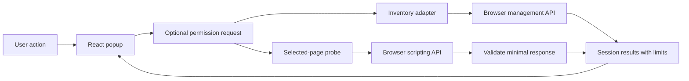

# Architecture

## Initial shape

Use WXT, TypeScript, and React in a single extension project. Configure Firefox and Chrome Manifest V3 explicitly because WXT's Firefox default is MV2. Reject other browser and manifest targets until separately approved. Start with a popup, small browser adapters, a capability model, and tests. Add a background coordinator only when a later recording workflow requires one. Firefox MV3 uses background scripts/event pages rather than a Chrome-only service worker.

The interface owns the temporary session. The inventory adapter accepts the browser API boundary and produces normalized entries. The probe adapter selects the active tab, injects a self-contained function into the default isolated world, validates its small response, and returns a typed outcome. A shared capability model describes supported, permission-dependent, unsupported, unavailable, and untested behavior without confusing those states.

The first Phase 1 slice adds an inventory-scoped React component with local search and state filters. It derives visible rows from the already loaded inventory and looks up static permission explanations without browser calls. The component exists only while the session has a successful inventory. Clear, revocation, refresh, and closing the popup remove it and discard its display state. The default black palette needs no saved theme preference.

## Permission boundary

Require only `activeTab` in the initial manifest. Declare `management` and `scripting` as optional. Request the relevant permission directly in the action handler, before unrelated asynchronous work can lose the user gesture. API access occurs only after the request succeeds. Requesting an already granted optional permission still follows an explicit click.

Do not declare broad host permissions, `tabs`, `webRequest`, `storage`, or `nativeMessaging` in Phase 0. A missing browser API is an unavailable outcome, not an excuse to request broader access.

## Data and trust boundaries

The inventory is sensitive because extension choices can reveal user interests. Keep it in the visible interface's memory. Normalize only fields the product displays. Do not load remote icons or contact extension homepages.

The page probe collects no identifiers or content. Validate document readiness against known values, performance type values as bounded strings, and response length before rendering. Render text through React. Do not insert HTML or execute returned strings.

Keep permission grants distinct from data retention. The browser can retain a grant after the popup closes. AddonRay retains no corresponding diagnostic history. In-flight operations must not repopulate cleared or revoked results.

## Manual comparison ownership

The approved [manual comparison](plans/phase1-comparison.md) adds an unlisted WXT investigation page and keeps the popup as a separate session. Each New investigation click creates a fresh extension-owned tab through `tabs.create` and `runtime.getURL`; no sensitive-metadata `tabs` permission is needed. Opening the route collects nothing.

`lib/investigation.ts` owns one Before/After pair and the user's assessment. It reuses the inventory adapter's explicit consent, then copies only the displayed ID/name/version/enabled fields. `lib/comparison.ts` computes exact-ID additions, removals and enabled-state transitions. Failed After captures retain Before for retry; a successful pair stays fixed until Start over. No comparison code selects or inspects a source page.

The loaded investigation document owns its memory and permission listener. Start over/revocation invalidate the generation and abort pending work; the last subscriber leaving discards the state. Fresh documents start empty. There is no transfer from the popup, background coordinator, storage, or single-instance coordination. [ADR 0003](adr/0003-investigation-page-lifetime.md) records the lifetime/recovery trade-off. Existing inspection permission grants can persist after every view has closed, independently of retained data.

## Future diagnostics

Introduce a background coordinator only when the approved workflow requires a longer session. Define the session lifetime, navigation behavior, event bounds, stop/clear behavior, and revocation handling before building a collector. Event pages can be suspended, so durable session behavior needs deliberate design and a privacy review.

Page errors, timing, mutation counts, and request failures are observations. Each event needs an observation source, time, frame scope, collection method, and uncertainty. Other extensions' private worlds and internal consoles are outside ordinary visibility. A page-world bridge, if approved, must validate messages, resist spoofing, and explain its interference risk.

## Optional Rust companion

This is a later feasibility project. Native messaging connects the extension to a separately installed local process with an explicit extension allowlist. It does not confer Firefox internal control. Define a versioned, bounded protocol and allowlisted read-only operations first. Require explicit installation and invocation, timeouts, cancellation, and safe handling of process failure.

Any proposal for browser control must identify a supported mechanism and obtain its own authorization. Profile database edits, hidden policy changes, and claims that native messaging bypasses browser permissions are outside the agreed design.

## Compatibility boundary

The approved targets are Firefox desktop MV3 at minimum 140 and Chrome desktop MV3 at minimum 156. `lib/browser-target.ts` maps WXT's build-time browser value to a closed context passed through the session, adapters, and UI. Unknown targets fail; the product does not inspect user agents. Conditional manifests include Gecko settings and Firefox data consent only for Firefox, and `minimum_chrome_version` only for Chrome. No background process is needed for either build.

The manifest minimum is a loading constraint, not proof of every release or OS. Exact distribution/version/OS evidence lives in dated reports. Edge, Safari, Android, and MV2 require separate decisions. The [test-authority ADR](adr/0002-test-authority-and-browser-qualification.md) distinguishes unmodified product consent from pre-granted Chrome UI fixtures.

## Sources

- [WXT browser targets](https://wxt.dev/guide/essentials/target-different-browsers)
- [WXT unit testing](https://wxt.dev/guide/essentials/unit-testing)
- [Firefox background manifest support](https://developer.mozilla.org/en-US/docs/Mozilla/Add-ons/WebExtensions/manifest.json/background)
- [Optional permissions](https://developer.mozilla.org/en-US/docs/Mozilla/Add-ons/WebExtensions/manifest.json/optional_permissions)
- [Native messaging](https://developer.mozilla.org/en-US/docs/Mozilla/Add-ons/WebExtensions/Native_messaging)
