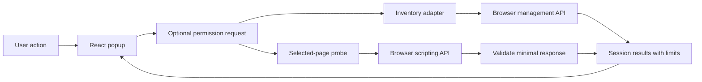

# Architecture

## Initial shape

Use WXT, TypeScript, and React in a single extension project. Configure Firefox and Chrome Manifest V3 explicitly because WXT's Firefox default is MV2. Reject other browser and manifest targets until separately approved. Start with a popup, small browser adapters, a capability model, and tests. Add a background coordinator only when a later recording workflow requires one. Firefox MV3 uses background scripts/event pages rather than a Chrome-only service worker.

The interface owns the temporary session. The inventory adapter accepts the browser API boundary and produces normalized entries. The probe adapter selects the active tab, injects a self-contained function into the default isolated world, validates its small response, and returns a typed outcome. A shared capability model describes supported, permission-dependent, unsupported, unavailable, and untested behavior without confusing those states.

The first Phase 1 slice adds an inventory-scoped React component with local search and state filters. It derives visible rows from the already loaded inventory and looks up static permission explanations without browser calls. The component exists only while the session has a successful inventory. Clear, revocation, refresh, and closing the popup remove it and discard its display state. The default black palette needs no saved theme preference.

## Permission boundary

Require only `activeTab` in the initial manifest. Declare `management` and `scripting` as optional. Request the relevant permission directly in the action handler, before unrelated asynchronous work can lose the user gesture. API access occurs only after the request succeeds. Requesting an already granted optional permission still follows an explicit click.

Do not declare broad host permissions, `tabs`, `webRequest`, `storage`, or `nativeMessaging` in Phase 0. A missing browser API is an unavailable outcome, not an excuse to request broader access.

## Data and trust boundaries

The inventory is sensitive because extension choices can reveal user interests. Keep it in the visible interface's memory. Normalize only fields the product displays. Do not load remote icons or contact extension homepages.

The page probe collects no identifiers or content. Validate document readiness against known values, performance type values as bounded strings, and response length before rendering. Render text through React. Do not insert HTML or execute returned strings.

Keep permission grants distinct from data retention. The browser can retain a grant after the popup closes. AddonRay retains live diagnostics only until their owning view ends; explicit Save creates a bounded local archive under the saved-investigation rules. In-flight operations must not repopulate cleared or revoked results.

## Manual comparison ownership

The approved [manual comparison](plans/phase1-comparison.md) adds an unlisted WXT investigation page and keeps the popup as a separate session. Each New investigation click creates a fresh extension-owned tab through `tabs.create` and `runtime.getURL`; no sensitive-metadata `tabs` permission is needed. Opening the route collects nothing.

`lib/investigation.ts` owns one Before/After pair and the user's assessment. It reuses the inventory adapter's explicit consent, then copies only the displayed ID/name/version/enabled fields. `lib/comparison.ts` computes exact-ID additions, removals and enabled-state transitions. Failed After captures retain Before for retry; a successful pair stays fixed until Start over. No comparison code selects or inspects a source page.

The loaded investigation document owns its memory and permission listener. Start over/revocation invalidate the generation and abort pending work; the last subscriber leaving discards the state. Fresh documents start empty. There is no transfer from the popup, background coordinator, storage, or single-instance coordination. [ADR 0003](adr/0003-investigation-page-lifetime.md) records the lifetime/recovery trade-off. Existing inspection permission grants can persist after every view has closed, independently of retained data.

## Approved timing snapshot

The first Phase 2 slice extends `PageObservation` in `lib/inspector.ts` with three fixed milestone results. The existing isolated-world collector reads the current top-frame document once and constructs only allowed fields. Its serialized function remains self-contained. It installs no listeners, observers, timers, or page-world bridge.

The adapter validates numeric bounds and measured/unrecorded/unavailable shapes before making independent canonical copies. Event-end zero is unrecorded; a reported zero paint timestamp remains valid. Missing APIs or entries remain unavailable. `PageTimings` renders the fixed results with meanings and limitations in the existing popup. The current session owns replacement, busy guards, clearing, cancellation, and permission listeners. No comparison owner, coordinator, message channel, navigation monitor, or durable state changes.

The selected tab is bound at the click, while its document at execution supplies the snapshot. The design does not claim exact click-time document identity. SPA navigation and restored pages may expose original loading milestones. Browser tests qualify isolated-world visibility, minimized raw output, the bounded block size, and synchronous execution overhead separately from test-controller authority and native popup behavior.

## Optional timing comparison integration

The approved [timing-comparison slice](plans/phase2-timing-comparison.md) extends the original independent-view model with explicit transfer. `capturePage` keeps the browser-selected tab ID and context classification beside its validated observation; `inspectPage` preserves the existing observation-only adapter contract. The popup session owns a capture sequence and one-use marker, separate from the page-provided timing block.

`lib/timing-handoff.ts` lists only own loaded investigation views through `extension.getViews`. Its public discovery result contains copied primitive identity/label/generation/eligibility metadata, with no Window reference or investigation data. At confirmation it resolves the chosen document again. The receiver verifies the current packaged popup, normal-window classification, permissions, reset generation, side eligibility, and current source capture before committing.

The investigation owns fixed optional Before/After timings and the source-tab binding. Starting After inventory closes Before timing attachment, even when inventory fails. Canonical timing objects are constructed in the receiving realm; discovery arrays and acknowledgments must likewise belong to their receiving document. Firefox can invalidate objects owned by closed views, so no sender-owned array/object/function enters retained snapshot state. Stale cross-view access becomes a bounded failure.

The transfer adds no background process, host grant, storage, external listener, page-world channel, or tab monitor. The views share the extension trust domain. Endpoint checks constrain product entry points; they do not create a security sandbox between compromised extension documents. Either optional-permission revocation resets the investigation, while popup Clear and other investigations remain independent.

## Approved page-error check design

The [approved collector](plans/phase2-page-errors.md) adds a separate unlisted check page with one in-memory attempt and a narrow browser adapter. `lib/page-error-check.ts` owns the bound source identity, start/stop/reset generations, canonical summary, and permission cancellation. It does not extend timing snapshots or investigation comparisons. The popup-to-check bootstrap must transfer only the selected numeric source-tab ID through a verified own-view boundary before activating the new check tab; IDs never enter the route.

[ADR 0004](adr/0004-page-error-execution-worlds.md) selects Firefox ISOLATED and Chrome MAIN only for error observation. `lib/page-error-observer.ts` installs an isolated supervisor connected to the original source frame and its visible check owner. Chrome's separate page-side function uses a narrow DOM control bridge without extension APIs or browser-action commands. Page-visible attempt tokens are not authentication secrets. `lib/page-error-browser.ts` requests consent, verifies context/access, controls the existing port and validates final results. Candidate lifecycle gates passed before product wiring; [delivery evidence](evidence/2026-10-24-phase2-page-errors.md) separates production-source qualification, instrumented cleanup, unmodified native observations and remaining gaps.

The collector has a 30-second eligible window and 200-event cap, returning only two event counts, total, fixed completion reason and bounded elapsed duration. Check the monotonic deadline before counting rather than relying solely on timer scheduling. The owner validates/copies the fixed result and ignores stale generations after discard/revocation. Page-side results remain untrusted and never carry raw event payloads. Navigation means interrupted without reattachment. No background coordinator or persistence is introduced.

## Page-error comparison ownership

The [approved comparison](plans/phase2-page-error-comparison.md) adds a narrow
check-tab sender in `lib/page-error-handoff.ts`. It preserves the timing receiver's
actual-popup boundary and the check launcher's separate bootstrap endpoint.
`lib/page-error-check.ts` owns current-attempt identity/generation, reservation and
one-use consumption. `lib/investigation.ts` owns fixed error slots, canonical
copies and the numeric source ID shared by all timing/error attachments.

Discovery returns copied identity/label/generation/side metadata. Confirmation
resolves the selected live document again and checks routes, contexts, permissions,
attempt, side, generation and source matching. A bounded action permit expires on
timeout/reset/teardown. The receiver copies the summary in its realm, then performs
only guarded private synchronous writes inside the donor reservation. The donor
marks successful use before notifications. Lost acknowledgment cannot make an
accepted check reusable. No foreign Window/object/function/array enters retained
UI or investigation state.

Missing transfer grants reject attachment without discarding a completed
standalone check; its permission-removal listener owns actual revocation.
Accepted copies outlive donor reset/closure under the existing temporary
investigation lifetime. Either permission revocation clears all observations.
All attachment kinds must match the first accepted source tab, including timing
Before after error Before. Attachment ordering proves no capture-time history or
page identity. No coordinator, storage, collector or new permission is added.
[Evidence](evidence/2026-10-26-phase2-page-error-comparison.md) separates the
prerequisite candidate, production source fixtures, native UI and remaining gaps.

## Approved report export ownership

The [report export plan](plans/phase3-report-export.md) adds a report derived from
one investigation's existing observations. `lib/investigation-report.ts` is a
pure serializer. It reuses the existing ID-based inventory comparison without
writing identifier fields to the report, escapes allowed text as literal values
and checks the complete UTF-8 output against the 1 MiB bound without truncation.
It reads no browser API or environment context.

`lib/report-export.ts` is the owning-view controller. It binds the preview
to the exact investigation snapshot reference and its reset generation. An
operation ticket invalidates pending preparation/download work. Before and after
asynchronous own-tab and permission checks, it verifies that the ticket,
snapshot reference and generation are still current. `tabs.getCurrent()` must
report `incognito: false`. `permissions.contains()` checks management, plus
scripting only when timing or error data is attached. A never-granted scripting
permission therefore does not block an inventory-only report. Invalid current
grants reset the investigation under its existing data boundary.

The controller subscribes to investigation changes and discards previews when
their source snapshot changes. It accepts a synchronous download callback;
there is no await between the final validity check and callback invocation. The
callback receives only the immutable preview string. The last subscriber leaving
or explicit disposal clears controller state and invalidates pending work.
Preparation and download add no inventory or page collection.

`lib/report-download.ts` requests an ordinary download using a UTF-8 Markdown
Blob and a temporary anchor with the generic filename. Its finally blocks remove
the anchor and synchronously revoke its object URL. It reports no browser
acceptance or completed-file status and retains no download owner.

The revised candidate gate passed, including ESR, before product wiring.
`entrypoints/investigation/main.tsx` creates the controller once for its owning
investigation and passes it through `App.tsx` to `ReportExport.tsx`. The component
subscribes to export state, shows a read-only textarea containing the exact
Markdown and offers Prepare report, Cancel and Download report. Successful
preparation focuses the preview. `pagehide` disposes the exporter before the
investigation resets, within its existing document lifetime.

Q12 distinguishes a download request from browser acceptance. The UI asks the
user to keep the view open until the browser shows the download and warns that
close/reload can cancel a pending request. Accepted bytes/files can outlive the
view; no background owner, broader permission or longer diagnostic retention is
added. The [candidate evidence](evidence/2026-10-27-report-export-feasibility.md)
preserves the original immediate-owner-close failures separately from the passed
revised candidate gate. Full product/browser/native qualification and signed
delivery remain pending.

## Saved investigation ownership

The [saved-data contract](plans/saved-investigation-data-rules.md) adds a
saved-archive owner separate from the live investigation. The Stage 1
IndexedDB candidate was accepted for the bounded #6 slice on 2026-10-30; save,
list, read-only reopen and single-record delete are implemented. Import, JSON
exchange, printable HTML, clipboard, retention choices and bulk deletion remain
future work.

`lib/saved-record.ts` is the pure schema/model boundary. It accepts one
completed, idle live snapshot, requires both successful inventories, strips
extension IDs and all live/transport identifiers, and retains only approved
inventory rows, precomputed ID-based changes, assessment, optional timing and
page-error summaries, fixed observation limits, a random local record ID and
local times. It checks string code points, nesting, inventory/change counts,
complete stored bytes including the local envelope, exact would-be exported
JSON bytes and the 30-day/90-day bounds without truncation.

`lib/saved-store.ts` owns extension-origin IndexedDB. One private meta record
holds a random store-instance ID and a deletion epoch. A save first reads that
state, then rechecks store identity, epoch, metadata, record count, aggregate
bytes and the candidate size inside one readwrite transaction before putting the
record. Success resolves only after the transaction completes. Deletes remove
one record and increment the epoch in the same transaction. Missing, corrupt or
exhausted metadata and recreated connections fail closed. Open, blocked and
transaction waits are bounded; pending writes abort on investigation reset. No
new permission is used, and no durability or background-cleanup guarantee is
added.

`lib/live-activity.ts` is the investigation's public action boundary. Capture,
attachment and report actions may overlap unless a save is pending. Save is an
exclusive lease: acquisition and the idle check are one synchronous operation,
and it blocks new live actions until the transaction settles. `saved-save.ts`
binds the exact snapshot reference and reset generation, reads the store state
as its first asynchronous step after the lease, then checks normal own-tab
context and current permission eligibility through the last abortable point.
Reset, assessment/attachment changes, permission removal or context loss abort
the pending write. Ordinary storage, quota or size failure keeps the live
investigation. A successful save notifies other views only as a hint.

`entrypoints/library` is a separate normal-window document. It lists records and
opens one inline read-only archive; it imports no inventory, session, collector
or source-tab code and requests no permission. Every read/action rechecks the
owning normal context and re-reads storage. Expired valid rows are removed
lazily; unsupported or unreadable rows stay visible for explicit deletion.
Deleting one record clears an open copy of that record. A cross-view
`BroadcastChannel` message only triggers a refresh; the next action never depends
on it. The popup launcher classifies the active tab of the current window and
requires `incognito === false`, so private, incognito and unknown contexts expose
no saved data. The library remains usable after management or scripting
permission removal.

The still-future import owner will validate a selected file, render it as
untrusted text and keep it separate from live observations. Persistence will
require a separate save and mark the record imported, subject to the
stored-record bound that includes the local envelope. The report-exchange owner
will use one bounded report model for JSON, printable HTML and clipboard, each
with its own exact preview and output lifetime. No PDF library, remote resource,
automatic sharing or collector is introduced.

## Expanded v1 target

The finite target is [the v1 contract](v1-contract.md). The sections below describe implemented slices and the boundaries future work must change deliberately. Saved investigations and report exchange (#5 to #11), guided trials (#12), mutation and request-failure checks (#13 to #19) and the optional companion (#20 to #28) each need their approved contract and feasibility proof before they alter permission, storage, lifetime or native boundaries. The extension-only inspection path remains useful without the companion.

## Future diagnostics

Introduce a background coordinator only when the approved workflow requires a longer session. Define the session lifetime, navigation behavior, event bounds, stop/clear behavior, and revocation handling before building a collector. Event pages can be suspended, so durable session behavior needs deliberate design and a privacy review.

Page errors, timing, mutation counts, and request failures are observations. Each event needs an observation source, time, frame scope, collection method, and uncertainty. Other extensions' private worlds and internal consoles are outside ordinary visibility. A page-world bridge, if approved, must validate messages, resist spoofing, and explain its interference risk.

The approved v1 tickets #13 to #19 define the next collector contracts. #33 characterizes existing budget variability without changing the agreed limits.

## Optional Rust companion

This was a later feasibility project. The approved v1 backlog now makes it concrete through #20 to #28. Native messaging connects the extension to a separately installed local process with an explicit extension allowlist. It does not confer Firefox internal control. #20 selects one versioned, bounded read-only operation and obtains a user verdict before implementation. #21 to #23 prove it per intended OS. #24 to #28 deliver, install, remove and upgrade it. Require explicit installation and invocation, timeouts, cancellation, and safe handling of process failure.

Any proposal for browser control must identify a supported mechanism and obtain its own authorization. Profile database edits, hidden policy changes, and claims that native messaging bypasses browser permissions are outside the agreed design.

## Compatibility boundary

The approved targets are Firefox desktop MV3 at minimum 140 and Chrome desktop MV3 at minimum 156. The v1 target keeps those distributions and intends macOS arm64, Windows x64 and Linux x64. Exact OS versions remain a release-planning gate. `lib/browser-target.ts` maps WXT's build-time browser value to a closed context passed through the session, adapters, and UI. Unknown targets fail; the product does not inspect user agents. Conditional manifests include Gecko settings and Firefox data consent only for Firefox, and `minimum_chrome_version` only for Chrome. No background process is needed for either build.

The manifest minimum is a loading constraint, not proof of every release or OS. Exact distribution/version/OS evidence lives in dated reports. Edge, Safari, Android, and MV2 require separate decisions, and v1 does not add them. The [test-authority ADR](adr/0002-test-authority-and-browser-qualification.md) distinguishes unmodified product consent from pre-granted Chrome UI fixtures.

## Sources

- [WXT browser targets](https://wxt.dev/guide/essentials/target-different-browsers)
- [WXT unit testing](https://wxt.dev/guide/essentials/unit-testing)
- [Firefox background manifest support](https://developer.mozilla.org/en-US/docs/Mozilla/Add-ons/WebExtensions/manifest.json/background)
- [Optional permissions](https://developer.mozilla.org/en-US/docs/Mozilla/Add-ons/WebExtensions/manifest.json/optional_permissions)
- [Native messaging](https://developer.mozilla.org/en-US/docs/Mozilla/Add-ons/WebExtensions/Native_messaging)
